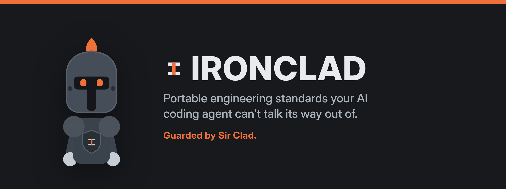

# Ironclad




[](https://github.com/psteixeira23/ironclad/actions/workflows/ci.yml)

An AI coding agent writes code that compiles, passes review, and still ships a table with no pagination or a duplicate CNPJ in the database.

Measured at `full`, the default through 1.6.2: quality barely moved (0.884 without this content set vs. 0.904 with it) while cost doubled, so quality per dollar fell by half. That's why `core` is the default now, see "A measurement" below.

Ironclad is a portable engineering governance toolkit for AI coding agents: a consistent set of architecture, security, testing, and process rules in one place, with a thin, harness-specific adapter per AI coding tool, so the same standards apply everywhere without being rewritten per project or per tool. Two things put it in charge rather than just on the record:

- **An intensity dial that governs how the agent works, not only which files it reads.** `core` (the default) plans and asks less, deferring to the escalation order in `ai-usage-policy.md`; `max` runs the alignment protocol on every non-trivial task and reviews its own output before calling anything done. The confirmation protocol for schema changes, new dependencies, and anything else irreversible holds the same at every level, see "Intensity levels" below.
- **Installation that does not depend on the harness deciding to load it.** Automatic skill invocation is probabilistic: in the same measurement, an identical prompt made the skill read zero files in one repetition and ten in the next. `ironclad init` writes a short, deterministic reminder into the project's `CLAUDE.md` instead, so the standard is consulted every time, see "Getting started" below.

## Support

If Ironclad saves you time, you can buy the developer a coffee. It is
optional and always will be. The project stays free and MIT-licensed
either way.


**Pix (Brazil).** Copy and paste the code below into your bank app, or
send to the random Pix key directly:

```
00020126580014br.gov.bcb.pix01368dd49726-758c-46e2-b096-2b6fd54dd07a5204000053039865802BR5908IRONCLAD6009SAO PAULO62070503***6304ACBD
```

Pix key (random): `8dd49726-758c-46e2-b096-2b6fd54dd07a`

## Why the name

An ironclad ship was armored to withstand what would sink an unprotected hull. The name is meant the same way here: a set of rules an AI coding agent cannot easily talk itself out of, sidestep under time pressure, or forget between sessions. The standards in `content/` exist so that architecture, security, and testing discipline hold up regardless of which project, which harness, or which conversation produced the code.

## Why this exists

An AI coding assistant is only as consistent as the instructions it is given. Left unguided across different projects and tools, it drifts: inconsistent architecture, insecure shortcuts, thin tests, and context wasted re-explaining the same standards every time.

Ironclad keeps the actual rules in one place, [`content/`](content/), and generates a small adapter per harness that imports from that single source instead of duplicating it. Update a rule once, every installed harness picks it up.

## What's inside

- **[`content/`](content/)**, the canonical engineering rules, one topic per file:

  | File                  | Covers                                                                                                                                        |
  | --------------------- | --------------------------------------------------------------------------------------------------------------------------------------------- |
  | `language.md`         | English-only rule for all project content and output.                                                                                         |
  | `plan.md`             | Alignment protocol run before coding: one question at a time, a short plan, then a go-ahead.                                                  |
  | `intensity.md`        | The three intensity levels (core, full, max) and how the active level is selected.                                                           |
  | `architecture.md`     | Layered architecture, dependency rule, SOLID.                                                                                                 |
  | `backend.md`          | Server-side validation, IDOR, mass assignment, error handling, sessions, passwords, CSRF, CORS, SSRF, path traversal, dynamic code execution. |
  | `frontend.md`         | XSS/output escaping, client-side storage, third-party script integrity, component structure.                                                  |
  | `database.md`         | Schema design, indexing, N+1 prevention, migrations, Row Level Security, preventing duplicate records under concurrency.                      |
  | `concurrency.md`      | Check-then-act in both shapes, atomic conditional updates, pessimistic and optimistic locking, concurrency testing.                           |
  | `security.md`         | Pre-launch and ongoing security checklist.                                                                                                    |
  | `testing.md`          | TDD, test scope, fragile tests, the coverage floor.                                                                                           |
  | `debug.md`            | Systematic debugging, local and production incidents.                                                                                         |
  | `refactor.md`         | Behavior-preserving change, characterization tests for legacy code.                                                                           |
  | `commits.md`          | Conventional Commits format, message content and length.                                                                                      |
  | `observability.md`    | Instrumenting a system and detecting when something is wrong.                                                                                 |
  | `resilience.md`       | Timeouts, retries, idempotency, graceful degradation for outbound calls.                                                                      |
  | `lgpd.md`             | Personal data protection (LGPD, GDPR, or equivalent), with extra guidance when minors are among the project's users.                          |
  | `ai-usage-policy.md`  | Team accountability for AI-generated code, and how the assistant should operate.                                                              |
  | `review-checklist.md` | The full code review checklist.                                                                                                               |
  | `quality-gate.md`     | Automated pre-merge gate (compile/type + lint) that blocks undefined symbols and type errors, per stack.                                      |
  | `task-routing.md`     | Table mapping task type to which files to read.                                                                                               |

- **`adapters/`**, per-harness templates that reference `content/` rather than copying it.
- **`installer/`**, a cross-platform Node.js CLI that installs the adapters for the harness(es) you choose, at the global (machine-wide) scope, so they apply to every project on that machine.
- **`bin/ironclad`**, a small global command the installer places on your `PATH`, currently used to check the installed version (`ironclad --version`).
- **`VERSION`**, the single source of truth for the current version, bumped automatically by the `pre-push` git hook, see "Versioning" below.

## Supported harnesses

| Harness        | Status                                                                                                                                            |
| -------------- | ------------------------------------------------------------------------------------------------------------------------------------------------- |
| Claude Code    | Tested: installs as a personal skill (`/ironclad`)                                                                                            |
| GitHub Copilot | Tested for always-on instructions; on-demand `/ironclad` invocation is limited to repository scope, see `adapters/copilot/README.md`           |
| OpenAI Codex   | Tested via global `AGENTS.md`; subject to a 32 KB instruction file limit, see `adapters/codex/README.md`                                       |

Installation is exercised in CI on Linux, macOS, and Windows, see "Testing" below.

## Getting started

```bash
git clone https://github.com/psteixeira23/ironclad.git
cd ironclad/installer
npm install
node install.js
```

The installer asks which harness(es) to set up and installs at the global scope. No project-specific configuration is required.

For Claude Code, also run this inside each project where Ironclad should apply, so the skill is consulted deterministically instead of relying on automatic invocation, which is probabilistic:

```bash
ironclad init
```

This writes a short, demarcated block into that project's `CLAUDE.md` (use `--path <dir>` to target a different directory). Safe to re-run; it updates the block in place.

## Checking the installed version

```bash
ironclad --version
```

Reports the version currently installed on this machine (from `~/.ironclad/VERSION`, written by the installer), not necessarily whatever this repository's checkout currently has. Re-run the installer after pulling changes to update it.

## Intensity levels

Ironclad runs at one of three levels, set per project by an `.ironclad`
file at the project root (or per session with `/ironclad core|full|max`
on Claude Code), defaulting to `core`. The level decides both how much
guidance loads and how the agent works:

- `core` (default): the security floor plus only the single most
  task-specific file. The agent plans only when the requirement is
  genuinely ambiguous after reading the code, and prefers stating an
  assumption over asking. Lowest token cost and fewest interruptions.
  Measured at `full` (the previous default) across 100 executions,
  this content set made no detectable difference to quality (0.884
  without it vs. 0.904 with it, p = 0.44, paired permutation test by
  task) while doubling cost per execution against no skill at all.
  `full` loads 6 to 12 files per task, floor included (observed range
  from two of the three rounds, reprocessed; not a guarantee); `core`
  loads the floor plus 1 task-specific file by definition. See "A
  measurement" below.
- `full`: the floor plus every file a task maps to, with the standard
  planning and confirmation behavior. Select it deliberately for work
  whose architectural surface is wide enough that `core`'s single file
  is not enough on its own.
- `max`: everything `full` loads, plus the alignment protocol on any
  non-trivial task, the review checklist applied to the agent's own
  output before it reports completion, and a mandatory coverage floor.
  For critical or personal-data work.

At every level, the agent applies the same scope discipline before
reporting a task as done: nothing outside the task was touched.

The security floor (`ai-usage-policy.md`, `language.md`, `security.md`,
and `lgpd.md` when personal data is involved) loads at every level, and
no level relaxes confirmation for a schema change, a destructive
migration, a new dependency, or anything else irreversible. The dial
trades thoroughness for speed, never safety. See `content/intensity.md`.

## A measurement

Three rounds, 100 executions, blind evaluation, pre-registered with a
hash. Two separate findings, kept separate because they are not the
same effect:

- **This content set made no detectable difference to quality**,
  measured at `full`: 0.884 without it vs. 0.904 with it (p = 0.44,
  paired permutation test by task). What *did* move, measurably:
  ordering validated against a closed list, a response size limit,
  and a uniqueness constraint enforced at the database level. Both
  get cited here, what moved and what did not.
- **`full` cost 2.03x more per execution** than no skill at all
  ($0.4860 vs. $0.2394). `full` loads 6 to 12 files per task, floor
  included (observed range from two of the three rounds, reprocessed;
  not a guarantee); `core` loads the floor plus 1 task-specific file
  by definition. That file-count gap is why `core` is the default
  now, not the content cuts below, which are a separate, smaller
  effect.
- **Automatic invocation is probabilistic, not a prompt-wording
  problem.** The same prompt made the skill read ten files in one
  repetition and zero in the next. `ironclad init` fixes this by
  writing the reminder directly into the project, see "Getting
  started" above.
- **The always-on floor shrank by evidence, not by size or style.**
  Two sections were removed from `content/ai-usage-policy.md` because
  72 of 72 measured executions, with or without the skill, never
  produced the error they guarded against: an invented symbol, a stub
  or TODO left behind, or a false claim that tests passed. 374 lines /
  19,133 characters before, 331 lines / 17,111 characters after, 11.5%
  fewer lines, 10.6% fewer characters, independent of which intensity
  level is selected. See `CHANGELOG.md` for the itemized cuts.

## Testing

Two suites guard the mechanism:

- An installer smoke test runs the installer into an isolated home
  directory and asserts it lands the expected files for all three
  harnesses. Run it with `cd installer && npm test`.
- A hook test drives the `pre-push` version-bump logic through `fix`,
  `feat`, breaking, no-op, and idempotent cases. Run it with
  `bash scripts/test-hook.sh`.

Both run in CI on every push and pull request: the installer smoke test
on Linux, macOS, and Windows, the hook test on Linux and macOS.

## Versioning

Version bumps are automatic, based on Conventional Commits (see `content/commits.md`): a `fix` commit bumps the patch number, a `feat` commit bumps minor, and a breaking-change marker bumps major. This happens locally, in a `pre-push` git hook, not in CI.

One-time setup per machine or fresh clone:

```bash
chmod +x scripts/setup-git-hooks.sh .githooks/pre-push bin/ironclad
./scripts/setup-git-hooks.sh
```

The hook creates its own commit for the version bump and stops the first push so that commit is included; pushing a second time goes through normally.

## Author

**Patrick de Souza Teixeira**
Coordinator of Software Engineering

- LinkedIn: [linkedin.com/in/patrick-de-souza-teixeira](https://www.linkedin.com/in/patrick-de-souza-teixeira/)
- GitHub: [github.com/psteixeira23](https://github.com/psteixeira23)

## License

MIT, see [LICENSE](LICENSE).
